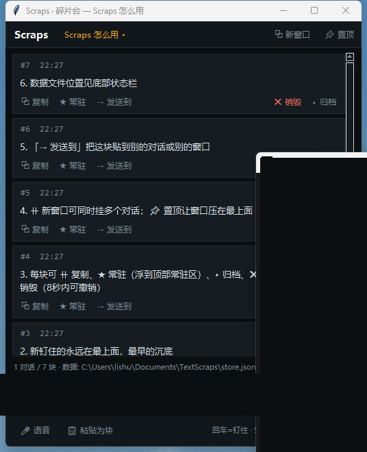

<div align="center">

# Scraps · 碎片台

**语音/文本碎片钉屏台 —— 说一条，回车，钉在最上面。**

Speak or type a line, press Enter, it's pinned on top. Newest always on top.

[](LICENSE)


</div>



## 这是什么

Scraps 是一个**超轻量的碎片暂存台**：开会、调试、边想边说的时候，脑子里冒出来的每段话——语音说的、临时打的、从别处复制的——随手钉成一个块，立刻可见、立刻可复制。

核心只有一条规则：**输入框在最下方，回车一条就钉上去；最新说的永远在最上面，最先说的沉底。**

没有账号、没有云端、没有依赖包，数据就是一个放在你电脑上的明文 JSON 文件。

## 特性

- ⚡ **极致轻量**：单文件 ~37KB，纯 Python 标准库（tkinter），零第三方依赖，秒开
- 🎤 **语音直录**：点 🎤 等同按 `Win+H`，调起 Windows 自带语音输入（免费、中英文都行），说完回车钉住
- 📌 **钉住流**：新块永远在最上，旧块按时间沉底，顺序一目了然
- ★ **常驻区**：重要的块一键「常驻」，浮到顶部不随时间下沉
- 🗂 **归档 / 销毁**：不想看但舍不得删的 → 归档（折叠区，随时恢复）；确定不要的 → 销毁（8 秒内可撤销）
- 🖥 **多窗口**：同时挂 N 个对话在屏幕上，任意窗口可「置顶」压在最上面
- ⇢ **发送到**：任意一块文字，一键贴到别的对话 / 新对话 / 别的窗口
- 📋 **一键复制**：单块复制，或整段对话带序号、时间戳复制进剪贴板
- 💾 **本地明文数据**：`Documents\TextScraps\store.json`，每次改动立即落盘，随时可看、可备份、可同步

## 快速开始

**方式一（推荐）**：克隆仓库后双击 `启动 Scraps.vbs`，无黑框直接出窗口。

**方式二**：命令行直接跑（任何平台有 Python + tkinter 都可以，界面功能完整；`启动 Scraps.vbs` 仅 Windows 便捷启动器）：

```bash
pythonw Scraps.pyw      # Windows 无控制台
python  Scraps.pyw      # 其他平台 / 想看输出
```

要求：Python 3.8+（只用标准库，`pip install` 什么都不需要）。

重复双击不会开出第二个实例——会把已存在的窗口调到最前面。关掉窗口即退出，数据已经实时保存。

## 用法

| 操作 | 方式 |
| --- | --- |
| 钉住一条 | 底部输入框打字 → **回车**（Shift+回车 = 换行），或点 `⏎ 钉住` |
| 语音输入 | 点 `🎤 语音` 或直接按 `Win+H`，说完回车钉住 |
| 粘贴为块 | `📋 粘贴为块`，剪贴板内容直接成块 |
| 复制 | 每块的 `⧉ 复制`；整段对话用顶栏「对话 ▾ → ⧺ 复制整段对话」 |
| 常驻 | `★ 常驻` 浮到顶部常驻区，再点取消 |
| 归档 / 恢复 | `▸ 归档` 收进底部折叠区；展开归档区点 `↩ 恢复` |
| 销毁 | `✕ 销毁`，状态栏 8 秒内可 `↩ 撤销` |
| 发送到 | `⇢ 发送到` → 选目标对话 / 新对话 / 其他窗口 |
| 多窗口 | 右上 `⧉ 新窗口` |
| 窗口置顶 | 右上 `📌 置顶` |
| 对话管理 | 顶栏 `对话 ▾`：新建 / 切换 / 重命名（也可双击对话名）/ 归档 / 销毁 |

## 数据

- 位置：`C:\Users\<你>\Documents\TextScraps\store.json`（窗口底部状态栏也显示这个路径）
- 格式：明文 JSON，每次操作立即原子落盘（先写临时文件再替换，不会写出半个文件）

```json
{
  "version": 2,
  "threads": [
    {
      "id": "8f2c1a9b77",
      "title": "灵感速记",
      "created": 1793456122.0,
      "updated": 1793457194.0,
      "archived": false,
      "blocks": [
        { "id": "a1b2c3d4e5", "text": "钉住的内容", "ts": 1793457190.0,
          "pinned": false, "archived": false }
      ]
    }
  ]
}
```

- 文件意外损坏时会自动备份为 `store.json.corrupt-<时间戳>` 并重建，绝不静默丢数据
- 想换数据目录：`pythonw Scraps.pyw --data D:\my-scraps`

## 命令行参数

| 参数 | 说明 |
| --- | --- |
| `--data <目录>` | 指定数据目录（默认 `Documents\TextScraps`） |
| `--smoke <目录> <报告文件>` | 冒烟自检：真实建 UI 走一遍核心链路（发块/排序/常驻/复制/移动/归档/多窗口/撤销），结果写入报告 JSON 后自动退出，不污染真实数据 |

## 常见问题

**语音输入支持中文吗？** 支持。`Win+H` 是 Windows 系统自带的语音输入，中文识别质量可用，完全免费、不联网到第三方。可在 Windows 设置里更改这个热键，Scraps 的 🎤 按钮发送的就是系统热键。

**换了 Python 安装路径怎么办？** 改 `启动 Scraps.vbs` 里的候选路径列表（纯文本，记事本可开），或直接用 `pythonw Scraps.pyw` 启动。

**数据能跨机器同步吗？** 能。把数据目录放到 Syncthing/Syncthing 类同步盘即可；JSON 是单文件原子写入，单机使用时不会产生冲突。

**为什么不用 Electron / web 页面？** 这个工具的定位是「快」：tkinter 是 Python 自带的，冷启动不到一秒、内存占用小、没有浏览器内核。代价是没有花哨动画——这是有意的取舍。

## 项目结构

```
Scraps/
├── Scraps.pyw        # 程序本体（单文件，纯标准库）
├── 启动 Scraps.vbs    # Windows 双击启动器（无控制台）
├── LICENSE           # MIT
└── README.md
```

代码结构：`Store`（JSON 原子读写 + 撤销栈）→ `Win`（单窗口 UI：顶栏/钉住流/输入条）→ `App`（多窗口广播刷新 + 单实例互斥）。约 1000 行，读完只要一杯咖啡的时间。

## 路线图（欢迎提 PR / Issue）

- [ ] 全局呼出热键（如 `Ctrl+Alt+Space` 唤出置顶小窗快速记一条）
- [ ] 系统托盘常驻
- [ ] 对话内文本搜索
- [ ] 导出为 Markdown

## License

[MIT](LICENSE) © zznmdhz

---

<div align="center">

用得顺手就点个 ⭐ Star 吧

</div>
